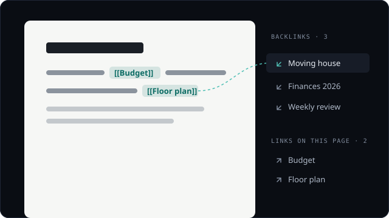
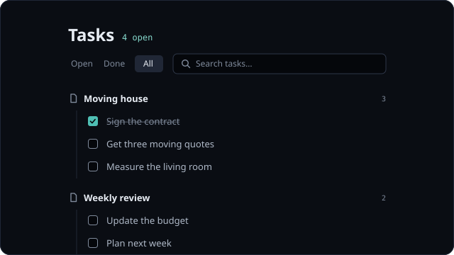
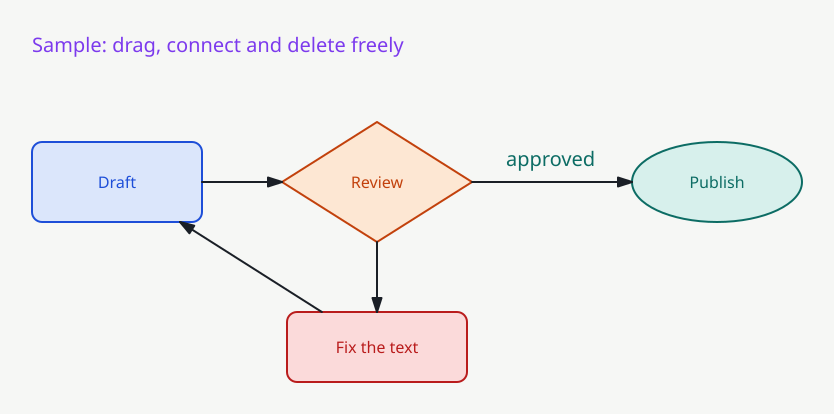
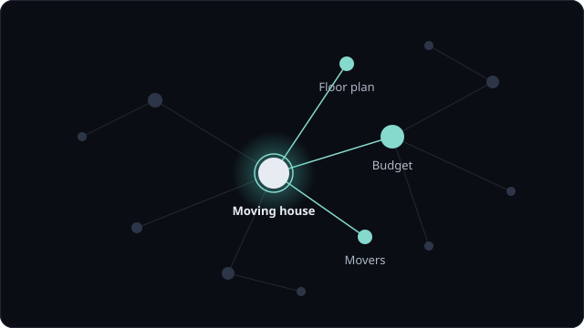
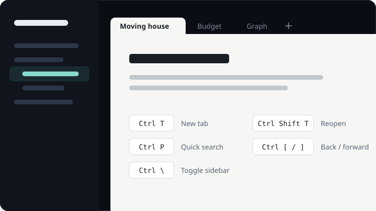
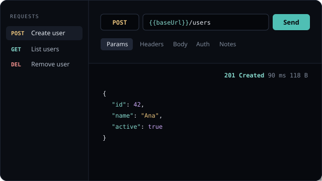
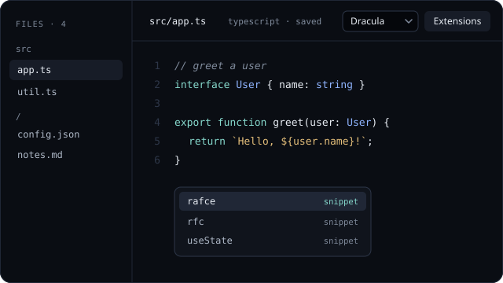
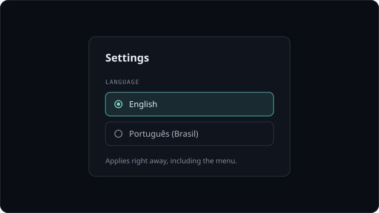

# ObNotion

A desktop app that merges the Obsidian model (notes as local Markdown files, `[[wikilinks]]`, backlinks, graph) with the Notion experience (block editor, `/` menu, tabs and shortcuts). It also ships an API client and a code editor, so notes, requests and code live in the same folder.

Everything is original code. Nothing was copied from Obsidian, Notion, Bruno or VS Code; their behavior was studied and reimplemented with open-source libraries.

## Getting started

```bash
npm install
npm run dev     # app with hot reload
npm start       # production build + app
npm run dist    # portable Windows executable in release/
```

On Windows you can also double-click `gerar-exe.bat` to build the executable.

On first launch, pick the vault folder (or drag a folder onto the window). It can be an existing Obsidian vault: files stay plain `.md` and YAML frontmatter is preserved. An empty vault offers a few example pages to start from.

## Features

### Block editor


Each note is a light page set into the dark frame. Type `/` to insert headings, lists, to-dos, tables, quotes and code blocks, and drag blocks to reorder them. The big title renames the file (`Esc` gives up on the typed name); characters that Windows or wikilinks cannot hold (`\ / : * ? " < > | # ^ [ ]`) are dropped.

- **Status bar** at the foot of the page: save state (Saved / Saving… / Not saved, with a retry), word and character counts and reading time. A failed save also shows a notice instead of failing silently.
- **Find in page** with `Ctrl+F`: matches are highlighted in place, `Enter` / `Shift+Enter` (or `F3`) step through them, with a match-case toggle. Highlights use the CSS Custom Highlight API, so the note's text is never touched.
- **Full width**: the button at the right of the status bar (or the command palette) drops the reading column for that page; the choice is remembered per page on this computer.
- **Templates**: pages inside the `Templates` folder (`Modelos` in Portuguese) can start a new page or be inserted at the cursor, from the command palette. `{{title}}`, `{{date}}`, `{{time}}` and `{{date:DD/MM/YYYY}}` (tokens `YYYY MM DD HH mm`) are filled in. A template named after the daily folder (`Templates/Daily`) becomes the starting text of each new daily note.
- **Daily notes** show the full date above the title, with buttons to the previous and next existing daily note and back to today.

`Ctrl+Shift+P` (File → Export as PDF…) saves the open page as an A4 PDF: title and content only, black on white, without the sidebar, tabs or links panel. The file is then shown in its folder.

### Wikilinks and backlinks



Link pages with `[[Page]]`, `[[Page|alias]]` or `[[Page#section]]`; type `[` to get page suggestions, and `[Page#` to pick one of that page's headings. A link with a section opens the page scrolled to that heading (it briefly glows), and the section survives editing. Links to pages that do not exist yet get a muted color and a dotted underline (still readable); clicking one creates the page, and renaming or moving a page updates every link that points to it. Hovering a link shows a preview card with the start of the page (or of the section); click its title to open it.

The side panel (wide windows) has:

- **Outline**: the page's headings; click one to jump to it. In a narrow window use *Go to a heading* in the command palette.
- **Backlinks**, each with the passage around the link.
- **Links in this page**.
- **Unlinked mentions** (collapsible): pages that mention this page's name as plain text (outside code, links and headings), with a *Link* button that turns those mentions into `[[links]]`, keeping the original wording as the alias.

### Tags

`#tag` in the text (outside code and links) and `tags:` in the frontmatter (inline list or YAML list) are collected into a collapsible Tags section of the sidebar, with counts; `#parent/child` tags nest under their parent, which also counts them. Clicking a tag opens quick search filtered by it.

### Tasks



`Ctrl+Shift+J` opens the Tasks tab, which gathers the to-do items (`- [ ]` and `- [x]`) from every note in the vault (front matter and fenced code are skipped). Every change rewrites only that task's line in the note's file, after checking the line is still the same task; if the note changed in the meantime the list refreshes and nothing is written.

- **Metadata in the text**, in the emoji format used by Obsidian task plugins, so notes stay portable: `📅 2026-10-20` due, `⏳` scheduled, `🛫` start, `✅` done date, `➕` created, `🔁 every week` recurrence, `🔺 ⏫ 🔼 🔽 ⏬` priority. They show as chips (relative dates such as "tomorrow" or "3 days ago", overdue in red, due today highlighted) instead of raw emoji; `#tags` and `[[links]]` in a task are clickable (a tag filters the list, a link opens the page).
- **Views**: Open, Today (due today or overdue), Next 7 days, Done and All. The header counts open, overdue and due-today tasks; the last two jump to the Today view.
- **Group** by note (with a progress bar of done/total and nested subtasks indented), folder, due date (Overdue, Today, Tomorrow, Next 7 days, Later, No due date), priority, tag or nothing; **sort** by note order, due date, priority or A–Z. Groups collapse one by one or all at once. View, grouping, sorting, collapsed groups and the quick-add target are remembered.
- **Search** with a small query language: plain words (text or path), `#tag`, `path:`, `due:today|overdue|tomorrow|week|later|none|YYYY-MM-DD|before2026-12-01|after…`, `priority:high` or `priority:high+`, `is:open|done|recurring|overdue|subtask`, quoted phrases, and `-` to negate any term.
- **Quick add**: type a task and press Enter; it is appended to today's note (created from the daily template if needed) or to a chosen note. Words like `today`/`hoje`, `tomorrow`/`amanhã`, `next week`/`próxima semana`, a weekday (`friday`, `sexta`) or a `YYYY-MM-DD` date become the due date, and `!1`–`!4` set the priority.
- **Completing** a task can record `✅ <date>` (on by default; reopening removes it). Completing a recurring task (`every day|week|month|year`, `every 3 days`, `every weekday`, or Portuguese forms like `a cada 2 semanas`, `todo mês`) inserts the next occurrence above it with its dates moved forward.
- **Edit** a task's text in place (double-click or `F2`), set or pick a due date, change the priority, copy or delete it from the right-click menu, and **undo** the last change (`U` or the Undo link). The locate button (or `Enter`) opens the note with the cursor on that task; `Ctrl+Enter` opens it in a new tab.
- **Copy** the visible tasks as Markdown, each with a `[[link]]` to its note.
- **Keyboard**: one Tab stop for the list; `↑`/`↓` or `J`/`K` move, `Space`/`X` complete, `T`/`M`/`W` due today/tomorrow/in a week, `D` pick a date, `1`–`4` priority and `0` normal, `Delete` delete, `←` collapse the group, `Shift+F10` menu. Outside the fields, `/` focuses search, `N` the quick-add field and `?` shows the shortcut list.

Custom statuses such as `[/]` (in progress) or `[-]` (cancelled) are not supported: the block editor only knows `[ ]` and `[x]`, and would turn other markers into plain text the next time the note is edited.

### Whiteboards



`Ctrl+Shift+B` (or **Whiteboards** in the sidebar) opens a whiteboard tab: a list of boards on the left and the canvas on the right.

- **Shapes**: rectangle, ellipse, diamond and free text, each with a label. Drag to move, pull a corner handle to resize (`Shift` keeps the proportions), double-click (or `Enter`) to edit the text.
- **Pencil, line and images**: the pencil draws freehand strokes (they scale when resized); the line tool draws a connector without an arrowhead. Raster images (PNG, JPEG, WebP, GIF) can be pasted, dropped on the canvas or inserted with `I`; large ones are scaled down to 1600 px and re-compressed so the board file stays small. SVG images are refused (they can carry scripts).
- **Style panel** (appears with a selection): stroke and fill colors, stroke width, solid/dashed/dotted, opacity, arrowheads (end, both, none), text size and a monospace font for code. Everything reaches the SVG/PNG export.
- **Arrange**: layers (`PageUp`/`PageDown`, with `Shift` to front/back), group/ungroup (a click selects the whole group), lock (locked elements can be selected and copied but not moved, edited or deleted), align (left, center, right, top, middle, bottom) and distribute with equal gaps.
- **Links**: `Ctrl+K` links an element to a vault note (path or name, `[[Note]]` works, with suggestions) or to an `http(s)` address. A badge marks linked elements; click it, use **Open link** in the panel, or `Ctrl+click` the element. Notes open in the app, sites in the system browser; any other scheme is rejected.
- **Find**: `Ctrl+F` searches element text and links (case- and accent-insensitive), with next/previous and the match brought into view.
- **Context menu**: right-click, `Shift+F10` or the menu key. Clipboard, layers, group, lock, link, copy as PNG, export the selection, zoom to selection, delete; fully keyboard-navigable.
- **Drawing helpers**: eraser (`E`, drag across elements), hand (`H`), keep the current tool after drawing (`Q`), `Shift` for squares / 15° angles / one-axis moves, `Alt`+drag to drag a copy, drag an arrow's end handle to reattach it to another shape or leave it loose, snap to grid (`Ctrl+'`), and a dark canvas (screen only; files and exports stay light). Grid, dark canvas and the export background are remembered on this computer.
- **Connectors**: the arrow tool draws from one shape to another; both ends stay attached and follow the shapes when they move. Select two shapes and press `C` to connect them without the mouse. Deleting a shape leaves its arrows in place with a loose end.
- **Boards**: create, rename (double-click or `F2` in the list, or edit the title), duplicate, open and delete (to the system trash, like notes); a filter appears when there are more than five boards. **Create sample** adds a small, clearly labelled sample board with a banner and a one-click delete.
- **Autosave**: every change is written to disk a moment later; the header shows *Saving…* / *Saved*, or an error with a retry button.
- **Import / export**: **JSON** (the full board, re-importable), **SVG** and **PNG** (2× resolution, white or transparent background), the whole board or only the selection; **Copy as PNG** (`Shift+Alt+C`) puts an image on the clipboard. Import takes a `.whiteboard.json` file; the file is validated first (see Limits).
- **Keyboard**: the canvas is focusable. `Tab` walks through the elements (each is announced with its kind and text), arrows nudge the selection (`Shift` for 10 px), `?` lists every shortcut.

| Action | Shortcut |
|---|---|
| Select / Rectangle / Ellipse / Diamond / Arrow / Text | `V` `R` `O` `D` `A` `T` (or `1`–`6`) |
| Pencil / Line / Eraser / Hand / Image / Keep tool | `P` (`7`) / `L` (`8`) / `E` / `H` / `I` / `Q` |
| Layer up / down (to front / back) | `PageUp` / `PageDown` (with `Shift`) |
| Group / Ungroup / Lock | `Ctrl+Shift+G` / `Ctrl+Shift+U` / `Ctrl+Shift+L` |
| Link / Find / Snap to grid | `Ctrl+K` / `Ctrl+F` / `Ctrl+'` |
| Context menu / Copy as PNG | `Shift+F10` / `Shift+Alt+C` |
| Delete / Duplicate / Select all | `Delete` / `Ctrl+D` / `Ctrl+A` |
| Copy / Cut / Paste (plain text becomes a text element) | `Ctrl+C` / `Ctrl+X` / `Ctrl+V` |
| Undo / Redo | `Ctrl+Z` / `Ctrl+Shift+Z` or `Ctrl+Y` |
| Zoom / 100% / Fit everything / Fit selection | `Ctrl`+wheel or `+` `-` / `0` / `Shift+1` / `Shift+2` |
| Pan | wheel, `Space`+drag or middle button |

**Data location and backup.** Each board is a file `Whiteboards/<name>.whiteboard.json` inside the vault (boards in other vault folders are listed too). Backing up the vault backs up the boards; the files are plain, versioned JSON (`"format": "obnotion-whiteboard", "version": 2`; version 1 files are upgraded on read, and older app builds refuse version 2 files instead of dropping what they do not know), so they can be diffed, synced or edited by hand. Nothing leaves the computer: no account, no network calls, no telemetry, no secrets (so there is nothing to add to a `.env`).

**Permissions.** None beyond what the app already has: boards are read and written through the same vault-restricted bridge as notes. Exporting opens the system *Save as* dialog.

**Architecture.** The module lives in `src/whiteboard/` and is loaded only when the tab opens:

- `model.ts`: file format, migration chain (files without `version`, from development builds, are upgraded on read; files from a newer version are refused, never overwritten), validation and pure editing operations (add, move, resize, connect, delete, duplicate, paste).
- `render.ts`: turns elements into drawing primitives; both the canvas and the SVG export draw from them, so exports match the screen.
- `storage.ts`: listing, reading, writing and the debounced autosave queue on top of `window.api`; PNG rasterization and downloads.
- `BoardEditor.tsx` (canvas, SVG + pointer events), `StylePanel.tsx` (selection panel), `Menu.tsx` (context menu), `Whiteboards.tsx` (list and states), `files.ts`, `sample.ts`, `i18n.ts`, `icons.tsx`.

The tab takes two optional props from the app, `notes` and `onOpenNote`, used only by element links. No new dependency was added.

The rest of the app only knows the `::whiteboards` tab, the sidebar entry and the menu item; removing the folder and those lines removes the feature.

**Limits.**

- Imported files over 5 MB or with more than 5000 elements are refused; unknown element types, invalid numbers or colors and arrows pointing at missing shapes are skipped (the board says how many). Text is limited to 2000 characters per element, and only `#rrggbb` colors reach the SVG.
- Images are embedded in the board file, which stays limited to 5 MB: an image that would push it past that is refused with a message. No curved or elbow connectors, rotation, frames, templates or shape libraries; the hand-drawn look of Excalidraw is not reproduced.
- Text does not wrap; shape labels are centered lines.
- No real-time collaboration or sharing; one window edits a board at a time. A board edited elsewhere (for example in the Code tab) while it is open is overwritten by the next change.
- Undo history is kept per open board and is lost when the board is closed or renamed.
- Exports use system fonts when the app font is not installed, so PNG/SVG text may look slightly different outside ObNotion. It does not import or export Excalidraw files.

### Graph



`Ctrl+G` opens the graph. It follows the same rules as the Obsidian graph: d3-force physics, node size by number of links, wheel zoom towards the cursor, draggable nodes, neighbours highlighted on hover, and labels that fade as you zoom out. The settings panel has filters, display options and the four force sliders.

- **Filter query**: terms must all match, `OR` separates alternatives, `-` excludes, quotes group words, and `path:`, `file:`, `tag:` and `content:` pick the field (`path:Projects -tag:archive`). An active filter shows as a chip with a clear button; when nothing matches, the graph says so and offers to clear it.
- **More nodes**: optional tag nodes (clicking one filters by that tag) and nodes for links whose page does not exist yet (dashed; click or Enter creates the page).
- **Color**: color groups (each a query plus one of eight palette colors, first match wins) and an optional color per folder. Node size can follow all links, incoming links only, or be the same for every node.
- **Local graph**: from the node menu or `L`, show only the neighbourhood of a node, with a depth from 1 to 5.
- **Nodes**: right-click (or `Shift+F10`) opens the node menu: open, open in a new tab, copy link, local graph, pin position, hide. `Ctrl+click` and middle click open in a new tab. Pinned nodes stay where they are dropped; hidden nodes come back with "Show all".
- **Camera**: zoom buttons, fit everything (`0`, or double-click on empty space), automatic fit once the layout settles, pause/resume the simulation (`Space`), and "Go to page" (`/` or `Ctrl+F` inside the graph) to center a page.
- **Keyboard**: the canvas is focusable; arrows move to the nearest node in that direction, `Enter` opens, `Ctrl+Enter` opens in a new tab, `P` pins, `H` hides, `Esc` clears the selection, `?` lists every shortcut. The selected node is announced to screen readers and shown in a card with its incoming and outgoing links.
- **Panel**: saved views (filters, groups, display and forces under a name), statistics (pages, unlinked pages, links without a page, tags, most connected pages) and PNG export with the app background.

Settings and saved views live in `localStorage` and are validated when read. The graph logic (query, local graph, statistics, keyboard navigation, fitting) is in `src/lib/graph.ts`, tested in `tests/graph.test.mjs`. Not there yet, compared to Obsidian: the timelapse animation (notes carry no creation date here) and attachments as nodes.

### Tabs and shortcuts



Pages open in tabs with their own back/forward history, next to a collapsible page tree. Shortcuts match the Notion desktop app.

**Quick search** (`Ctrl+P`) matches page names loosely, VS Code style (`cn` finds *Casa nova*, matched letters highlighted), then the text inside notes, showing the passage around each hit. Narrow it with `tag:name` (or `#name`) and `path:folder`; `Ctrl+Enter` opens the result in a new tab, `Enter` on an unknown name creates the page. Start with `>` to get the **command palette**: every menu action plus page commands (rename, duplicate, move, move to trash, insert template, go to heading, random page, full width, pin tab…), each with its shortcut.

**Page tree**: right-click a page (or press the menu key / `Shift+F10`) for open in new tab, rename, duplicate, move to…, favorite, copy link and move to trash. On a focused row, `F2` renames in place, `Delete` moves to the trash and the arrow keys walk the tree. Drag a page onto a folder (or onto the *Pages* header for the vault root) to move it. The filter field above the tree narrows it to matching pages; the buttons beside *Pages* reveal the open page and collapse or expand every folder. The open page's folders open by themselves. Moving a page to the trash shows a notice with **Undo**, which recreates it with the same text.

**Tabs**: right-click a tab to pin it, duplicate it, copy its link or close it, the others or the ones to its right. A pinned tab stays at the left, ignores `Ctrl+W` and opens links in a new tab. Drag tabs to reorder them (`Shift+←/→` on a focused tab). With many tabs open the strip scrolls sideways (the mouse wheel works too) instead of squeezing the names; a faded edge shows there are more, and the active tab is always scrolled into view. The open tabs, their history and pins come back the next time the vault is opened.

Star a page to pin it in a Favorites section above the page tree: from the links panel, the star beside the title in smaller windows, the page tree, or `Ctrl+Shift+F`. The last 20 pages you opened come first in quick search while the field is empty, and the most recent ones are listed on the home screen when no page is open. Both lists are kept per vault.

| Action | Shortcut |
|---|---|
| New page / New tab | `Ctrl+N` / `Ctrl+T` |
| Today's note (one page per day, in the `Daily` folder) | `Ctrl+D` |
| Close tab / Reopen last closed | `Ctrl+W` / `Ctrl+Shift+T` |
| Next / previous tab | `Ctrl+Tab` / `Ctrl+Shift+Tab` |
| Back / Forward | `Ctrl+[` / `Ctrl+]` |
| Toggle sidebar | `Ctrl+\` |
| Collapse sidebar into icons (focus mode) | `Ctrl+Shift+\` or the panel button next to the vault name |
| Copy page link / page name | `Ctrl+L` / `Ctrl+Alt+L` |
| Add / remove current page from favorites | `Ctrl+Shift+F` |
| Find in page | `Ctrl+F` |
| Rename / move to trash the focused page in the tree | `F2` / `Delete` |
| Context menu of the focused tree row or tab | `Shift+F10` or the menu key |
| Export page as PDF | `Ctrl+Shift+P` |
| Paste without formatting | `Ctrl+Shift+V` |
| Quick search (creates the page if missing) | `Ctrl+P` |
| Tasks | `Ctrl+Shift+J` |
| Whiteboards | `Ctrl+Shift+B` |
| Graph / Requests / Code | `Ctrl+G` / `Ctrl+Shift+E` / `Ctrl+Shift+K` |
| Open another vault | `Ctrl+O` |
| Quit | `Ctrl+Shift+Q` |

The menu bar is hidden; press `Alt` to show it. In a narrow window (under 900 px) the sidebar collapses into an icon rail; use quick search to reach pages. Between 900 and 1280 px the sidebar and links panel get slimmer so the page keeps a comfortable column, and the page's margins and title shrink with it. In a short window (under 620 px tall) the sidebar's shortcuts become a single row of icons (hover for the name and shortcut), leaving the height to the page tree. With the sidebar hidden (`Ctrl+\`), a button at the left of the tabs brings it back.

### Requests



`Ctrl+Shift+E` opens an API client. Each request is a `.bru` file inside the vault, in the same format Bruno uses, so the `Requests` folder opens as a collection in Bruno and a Bruno collection copied into the vault shows up here.

- Method, URL, query parameters (kept in sync with the URL) and headers, with suggestions for common header names and values.
- **Path parameters**: write `:name` in the URL (`/users/:id`) and fill its value in its own table, as in Bruno. The URL that will actually go out, with variables and path parameters applied, shows under the URL bar.
- **Import from cURL**: paste a `curl` command into the URL field and the method, URL, headers, body and Basic/Bearer authentication are filled in.
- **Generate code**: **Code** shows the request as cURL, JavaScript `fetch`, Python `requests` or raw HTTP, with the active environment applied, ready to copy.
- Body as JSON, text, XML or URL-encoded form. **Format JSON** (or `Shift+Alt+F` in the body) pretty-prints it while keeping `{{variables}}`, and points to the line and column of a syntax error.
- **Bulk edit** for params, headers and form fields: one `name: value` line per pair, `//` disables a line.
- Bearer, Basic and API key authentication; tokens, passwords and key values stay hidden until you click the eye.
- Environments with `{{variables}}`, and a warning when one used by the request has no value (notes and disabled rows don't count). Environments can be renamed, duplicated and moved to the trash.
- **Assertions** in Bruno's `assert` block (`res.status: eq 200`, `res.body.users.length: gt 0`, `res.headers.content-type: contains json`), checked on every send and listed in the response's **Tests** tab. Supported operators: `eq`, `neq`, `gt`, `gte`, `lt`, `lte`, `in`, `notIn`, `contains`, `notContains`, `length`, `matches`, `notMatches`, `startsWith`, `endsWith`, `between`, `isEmpty`, `isNotEmpty`, `isNull`, `isUndefined`, `isDefined`, `isTruthy`, `isFalsy`, `isJson`, `isNumber`, `isString`, `isBoolean`, `isArray`.
- Response status, time, size, headers and cookies. The body can be shown pretty or raw, searched (matches highlighted; `Enter`/`Shift+Enter` jump between them), narrowed with a JSON filter (`users[0].name`, `$.items[*].id`, `[-1]` for the last item), copied, or saved as a new page. `Ctrl+Enter` sends; a running request can be cancelled.
- **Collection**: folders collapse (remembered per machine), a filter box searches names, URLs and folders (`post`, `get`… filter by method), and each folder can create a request inside it, **run** all its requests in order with a pass/fail summary (runs stay out of the history), or **generate a documentation page** listing every request with its parameters, headers, body and assertions.
- Notes per request. Blocks the screen does not edit (scripts, tests, vars) are kept in the file.
- **Saving**: edits stay as an unsaved draft (dot in the list) until `Ctrl+S` or **Save**; drafts survive switching requests and tabs. **Save as…** and **Duplicate** write a copy under a new name or folder.
- **Mentions in pages**: type `[` in a page and pick a request; it shows as a chip with its method and opens the request when clicked. **Copy link** gives the same `[[Requests/Name.bru|Name]]` link to paste. Each request lists the pages that mention it, and a page's links panel lists its requests.
- **History**: every send is kept with its response (last 200, in `.obnotion/request-history.json` inside the vault), grouped by day and filterable by text and status class (2xx, 4xx, failed…). Open one to read the response again, send it again, save it to the collection, save the response as a page or jump to the original request. Opening a request shows its last response.
- Keyboard: the request and history lists open with `Enter` and move with the arrow keys; `Esc` clears the filters.

The request logic that doesn't touch the screen (cURL parsing, code generation, path parameters, assertions, JSON filter, Markdown generation) lives in `src/lib/requestTools.ts` and is covered by `tests/requests.test.mjs`.

Not there yet, compared to Bruno: pre/post-request scripts and `tests` blocks in JavaScript, GraphQL, gRPC, WebSocket, OAuth2/AWS/NTLM, multipart and file upload, a cookie jar shared between requests, proxy and certificates, Postman/OpenAPI import, auth inherited from the collection, Git integration, secret variables.

### Code



`Ctrl+Shift+K` opens a workbench laid out like VS Code, built on Monaco (the editor inside VS Code):

- **Explorer** for any folder on disk (the vault by default; `Open folder…`, `Open file…` and recent folders from the buttons above it). `Add folder to workspace…` opens several projects side by side, as a VS Code multi-root workspace, with new file/folder, rename, **duplicate**, **drag and drop to move** (open tabs follow), delete to trash, copy absolute or relative path, reveal in File Explorer and live refresh when files change on disk. The tree works from the keyboard (arrows, `Home`/`End`, `F2`, `Delete`, `Shift+F10` for the context menu) and says when a folder is loading or can't be read.
- **Search** (`Ctrl+Shift+F`, the selection becomes the query): every file in the open folders, with match case, whole word (accent-aware) and regular expression (`Alt+C`/`Alt+W`/`Alt+R`), files to include/exclude as globs (`src, *.ts` / `dist, *.min.js`), results grouped by file with the match highlighted. **Replace** (`Ctrl+Shift+H`) previews each change and replaces in one file or everywhere; files open in the editor change in place (undo with `Ctrl+Z`), the rest on disk. **Find in folder…** in the explorer's context menu scopes the search to a folder.
- **TODOs** view: every `TODO`, `FIXME`, `HACK`, `XXX`, `BUG` and `NOTE` comment in the workspace, filterable by tag and refreshed when files change.
- **Editor tabs** with preview tabs (single click, italic), dirty markers, auto save (toggle in the status bar) and `Ctrl+S`. Right-click (or `Shift+F10`) a tab to close others / to the right / saved / all, **pin** it (pinned tabs stay on the left and survive "close others"), compare with saved, copy its path or reveal it. `Ctrl+Shift+T` **reopens the last closed editor**, and the open tabs of each workspace **come back when the app restarts**. Arrow keys move between tabs and `Delete` closes one.
- **Breadcrumbs** you can click: a folder lists its contents (folders drill down, files open); the file name opens its symbols.
- **Quick Open** (`Ctrl+P`, `file.ts:12:4` jumps to a line and column), **Command Palette** (`Ctrl+Shift+P` or `F1`, including every Monaco editor action), go to line (`Ctrl+G`), go to symbol (`Ctrl+Shift+O`) and **go back / forward** between positions (`Alt+←` / `Alt+→`), across files.
- **Compare with saved** (`Ctrl+K D`): the file on disk next to your unsaved edits, side by side or inline, with a change count.
- **Markdown preview** to the side (`Ctrl+K V`): headings, task lists, quotes, tables, highlighted code, front matter and `[[wikilinks]]`. It follows the cursor, double-clicking a block moves the cursor there, relative links open the file and web links open in the browser. The preview is built from a syntax tree (no HTML from the file is rendered) and does not load images.
- **Problems** panel (`Ctrl+Shift+M`, or click the error/warning counts in the status bar): diagnostics grouped by file with a filter; it shares the bottom panel with the terminal.
- **Integrated terminal** (`` Ctrl+` ``, new with `` Ctrl+Shift+` ``): real PowerShell sessions through a pseudo-terminal, several at once, kept alive when you switch tabs. **Run active file** (`Ctrl+Alt+N`) saves and runs it with the language's runner (`node`, `node --experimental-strip-types` for TypeScript, `python`, `ruby`, `go run`, `bash`, PowerShell…); **Run selected text** sends the selection (or the current line).
- **On save** (only when you save, never on auto save): format document, trim trailing whitespace (Markdown is left alone, where two spaces mean a line break) and insert a final newline, each toggled from the palette.
- **View options** from the palette: render whitespace, line numbers (absolute, relative, hidden), sticky scroll, minimap, word wrap (`Alt+Z`), font size. **Zen mode** (`Ctrl+K Z`) hides everything but the tabs and the editor.
- **Copy as Markdown block**: the selection (or the whole file) as a fenced block headed by its relative path and line numbers, ready to paste into a page.
- **Language servers**: the native TypeScript 7 server (`tsc --lsp`) for TypeScript/JavaScript and the VS Code JSON, CSS/SCSS/Less and HTML servers. Project-aware completions, hover, diagnostics, go to definition/references across files (`F12`, `Shift+F12`), rename, formatting, and JSON validation with the schemas VS Code extensions declare (package.json, tsconfig.json…).
- **Status bar** with errors/warnings, cursor position, indentation, line endings and language mode, each clickable as in VS Code.

In the Code tab a few app shortcuts take their VS Code meaning: `Ctrl+P` (Quick Open), `Ctrl+Shift+P` (palette), `Ctrl+G` (go to line), `Ctrl+N` (new file), `Ctrl+W` (close editor), `Ctrl+Shift+F` (search instead of favorite) and `Ctrl+Shift+T` (reopen editor; with nothing to reopen it falls back to reopening an app tab). Search and replace run in the main process with the same folder checks as the rest of the workspace (files over 1 MB, binaries, `.git` and `node_modules` are skipped; at most 2,000 results). The search/replace logic is shared by both sides in `electron/searchCore.mjs`; pure rules (tab closing, navigation history, save helpers, runners, Markdown snippet, saved tabs, file patterns) are in `src/lib/codeTools.ts` and the Markdown preview parser in `src/lib/markdownPreview.ts`, covered by `tests/codeSearch.test.mjs`, `tests/codeTools.test.mjs` and `tests/markdownPreview.test.mjs`.

ObNotion reads the extensions already installed in your VS Code (the built-in ones and those in `~/.vscode/extensions`):

- **Color themes** recolor the whole workbench (side bar, tabs, status bar, terminal, pickers) and the code. `Preferences: Color theme` (`Ctrl+K Ctrl+T`) previews each theme as you move through the list.
- **TextMate grammars** do the syntax highlighting, through the same engine as VS Code (`vscode-textmate` + Oniguruma), so the colors match VS Code's.
- **File icon themes** (Seti by default, Minimal, Modern or any installed one) in the explorer, tabs and Quick Open.
- **Languages and language configuration** (file associations, comments, brackets, indentation rules) and **snippets**.
- There is no extensions view: what the installed extensions contribute just works. Extensions that run their own code in the VS Code extension host (ESLint, Prettier, debuggers, Git, assistants) do not run here.
- AI features of editors like Cursor (chat, inline edits, completions from a model) are not included: they need an online service, and the app stays local and offline.

### Welcome, home screen and settings



**Welcome** (no vault open): choose a folder (`Ctrl+O`), drag one onto the window, or reopen one of the last eight vaults; missing folders are marked and can be removed from the list. If the last vault's folder is gone (unplugged drive, moved folder) the screen says so, with *Try again* and *Forget*. The language can be switched right there, before choosing anything.

**Home screen** (no page open): a greeting with today's date, the vault's numbers (pages, folders, open tasks, tags, words; the task count opens the Tasks tab), start tiles for search, new page, today's note, graph, tasks, whiteboards, new from template and a random page, then favorites and recent pages (remove one, or clear the list) and a tip of the day (*Another tip*, or hide them). An empty vault gets **Create example pages**: a start page, a shortcuts page, an ideas page and a daily-note template in the templates folder; nothing is overwritten.

**Settings** (`Ctrl+,`) has sections (General, Appearance, Editor, Vault, Shortcuts, About) and a search field that filters every setting and shortcut by name, description or keys, ignoring case and accents (`Esc` clears the search, then closes).
- General: interface language (English or Brazilian Portuguese, applied at once, menu included); what opens on startup (last session's tabs, those plus today's note, or the home screen); the folder where `Ctrl+N` and quick search create pages (per vault); tip of the day; restore defaults.
- Appearance: accent color (five presets) and animations (follow the system, reduced or full).
- Editor: page text size (13 to 22 px, separate from window zoom) and spell check (the system dictionary).
- Vault: the folder with *Show in file explorer* and *Switch vault*, its numbers, and the other recent vaults.
- Shortcuts: every keyboard shortcut, searchable.
- About: version, Electron, Chromium, Node and OS (copyable), and the app data folder.

Preferences are saved in the app's `config.json` and checked field by field when read (`src/lib/prefs.ts`); the recent-vault list lives there too (`electron/vaults.cjs`). Tests: `tests/home.test.mjs`.

## Known limits

- Converting between blocks and Markdown is lossy: when you edit a note its formatting is normalized (for example `-` lists become `*` and tables are realigned). Opening a note without editing does not touch the file.
- Obsidian-only syntax (callouts `> [!note]`, embeds `![[...]]`, Dataview, canvas) shows as plain text.
- No Notion databases, no sync, no plugins.
- Files and folders starting with `.` are ignored.
- Favorites, recent pages, the tab session, full-width pages and the folder for new pages are stored in the app, keyed by the vault's folder path, not in the vault: moving or renaming the vault folder resets them.
- The daily-note and template folders follow the interface language (`Daily`/`Templates` in English, `Diário`/`Modelos` in Portuguese).
- Find in page searches the visible text of the editor; there is no replace.

## Project layout

- `electron/main.cjs`: window, menu, disk access restricted to the vault, HTTP requests, VS Code extension reader.
- `electron/workspace.cjs`: the Code tab's open folder (file access limited to it, the vault and files picked in a dialog), its file watcher and search/replace in files (`electron/searchCore.mjs`, shared with the renderer).
- `electron/terminal.cjs`, `electron/lsp.cjs`: terminal sessions and language server processes.
- `electron/vaults.cjs`: recent vault list and stored preferences.
- `electron/preload.cjs`: the `window.api` bridge.
- `src/App.tsx`: state (tabs, link index).
- `src/whiteboard/`: the whiteboard module (see Whiteboards above).
- `src/components/`: `Welcome` (no vault), `Home` (no page open), `Settings`, `Editor` (BlockNote + wikilinks), `NoteTools` (find bar, status bar), `LinkPreview`, `DailyNav`, `ContextMenu`, `Sidebar`, `Panels` (tabs, links panel, quick search and command palette), `Graph`, `Tasks`, `Requests` and its parts in `requests/` (response panel, code dialog, folder runner), `Code` and its parts in `code/` (explorer, quick input, terminal, search, TODOs, problems, compare with saved, Markdown preview).
- `src/lib/`: preferences (`prefs.ts`, `prefsContext.tsx`), home screen logic (`home.ts`), settings search, link parsing, graph logic (`graph.ts`), note logic (`notes.ts`: tags, headings, word counts, mentions, search, templates), tabs and session (`tabs.ts`), task extraction, `.bru` request model and request tools (`requestTools.ts`: cURL, code generation, assertions, JSON filter), VS Code themes and snippets, TextMate grammars (`textmate.ts`), icon themes, workbench colors, the LSP bridge (`lsp.ts`).
- `tests/`: unit tests for `src/lib` and `src/whiteboard`, run with `npm test` (Node's built-in test runner). `npm run test:e2e` builds the app and runs `tests/e2e/whiteboard.e2e.mjs`: it starts the real Electron app off-screen with a temporary vault (through the existing `OBNOTION_SHOT`/`OBNOTION_EVAL` test hooks, no extra dependency), creates a board, draws, moves and connects shapes, adds a pencil stroke, exports SVG and PNG, then relaunches the app and checks that autosave kept everything.
- `docs/`: illustrations used in this file.

## Credits

Built on [Electron](https://www.electronjs.org/), [React](https://react.dev/), [BlockNote](https://www.blocknotejs.org/), [d3-force](https://d3js.org/d3-force), [Monaco Editor](https://microsoft.github.io/monaco-editor/), [vscode-textmate](https://github.com/microsoft/vscode-textmate), [xterm.js](https://xtermjs.org/), [node-pty](https://github.com/microsoft/node-pty), [vscode-langservers-extracted](https://github.com/hrsh7th/vscode-langservers-extracted) and [`@usebruno/lang`](https://www.npmjs.com/package/@usebruno/lang).
